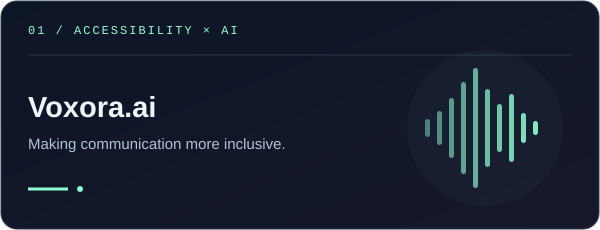
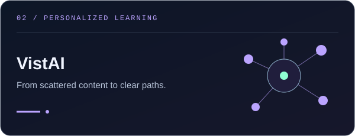
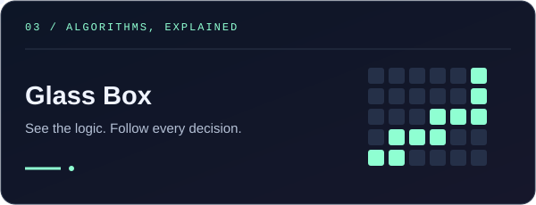
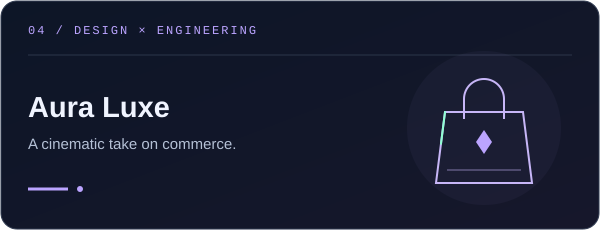
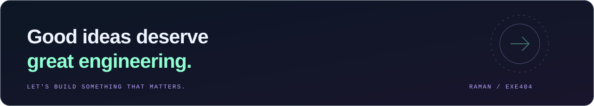

<div align="center">

<picture>
  <source media="(prefers-reduced-motion: reduce)" srcset="./assets/hero-static.svg">
  
</picture>

<br><br>

**Java Backend Developer &nbsp; / &nbsp; AI Builder &nbsp; / &nbsp; Full-Stack Engineer**

I build at the intersection of reliable systems, useful AI, and thoughtful interfaces.

<a href="https://www.linkedin.com/in/ramandeep-singh-425a532a6/"></a>
&nbsp;
<a href="mailto:ramandeepsinghrds2006@gmail.com"></a>
&nbsp;
<a href="https://github.com/raman-exe404?tab=repositories"></a>

<br><br>

[Selected work](#selected-work) &nbsp; · &nbsp; [Engineering DNA](#engineering-dna) &nbsp; · &nbsp; [Toolkit](#toolkit) &nbsp; · &nbsp; [Activity](#activity) &nbsp; · &nbsp; [Connect](#connect)

</div>

<br>

## Engineering DNA

**The interface gets your attention. The engineering earns your trust.**

I'm Ramandeep, a developer from India focused on **Java, Spring Boot, AI integration, and system design**. I enjoy taking an idea all the way from the first sketch to a working experience—not just making it function, but making it make sense.

```java
public record Developer(String name, String focus, String mindset) {
    public static Developer raman() {
        return new Developer(
            "Ramandeep Singh",
            "Reliable backends. Useful AI. Thoughtful experiences.",
            "Understand deeply. Build deliberately. Keep improving."
        );
    }
}
```

| Backend depth | Applied intelligence | Product thinking |
| :--- | :--- | :--- |
| Java and Spring Boot, with a focus on clear architecture and maintainable systems. | Connecting models, data, and interfaces to solve real human problems. | Bringing backend logic and frontend detail together into a coherent experience. |

<br>


## Selected work

A few things I've built. Different domains. The same instinct: **make complexity useful.**

<table>
<tr>
<td width="50%" valign="top">

<a href="https://github.com/raman-exe404/Voxora.ai"><picture><source media="(prefers-reduced-motion: reduce)" srcset="./assets/project-voxora-static.svg"></picture></a>

### Voxora.ai
**Giving signs a voice.**

Real-time ASL recognition that turns hand signs into text and speech, with sentence formation and AI-assisted corrections.

`Python` `Flask` `React` `TensorFlow` `OpenCV`

[Explore the code →](https://github.com/raman-exe404/Voxora.ai) &nbsp; [Watch the demo ↗](https://youtu.be/cvyST-QWqhw)

</td>
<td width="50%" valign="top">

<a href="https://github.com/raman-exe404/VistAI"><picture><source media="(prefers-reduced-motion: reduce)" srcset="./assets/project-vistai-static.svg"></picture></a>

### VistAI
**Less information overload. More direction.**

An AI-powered learning platform that organizes educational content into personalized paths, notes, quizzes, and progress tracking.

`TypeScript` `AI-generated notes` `Learning paths`

[Explore the code →](https://github.com/raman-exe404/VistAI)

</td>
</tr>
<tr>
<td width="50%" valign="top">

<a href="https://github.com/raman-exe404/Algorithmic-GlassBox-Simulator"><picture><source media="(prefers-reduced-motion: reduce)" srcset="./assets/project-glassbox-static.svg"></picture></a>

### Algorithmic Glass Box
**Algorithms shouldn't be black boxes.**

An interactive pathfinding lab that makes BFS, DFS, Dijkstra, and A* visible, explainable, and comparable—one decision at a time.

`React` `TypeScript` `Pathfinding` `Visualization`

[Explore the code →](https://github.com/raman-exe404/Algorithmic-GlassBox-Simulator) &nbsp; [Live experience ↗](https://algorithmic-glass-box-simulator.vercel.app)

</td>
<td width="50%" valign="top">

<a href="https://github.com/raman-exe404/Aura_Luxe"><picture><source media="(prefers-reduced-motion: reduce)" srcset="./assets/project-aura-static.svg"></picture></a>

### Aura Luxe
**Engineering with an eye for detail.**

A cinematic e-commerce experience for Aura Luxe Bags, with curated collections, product showcases, and an admin dashboard.

`TypeScript` `E-commerce` `Product experience`

[Explore the code →](https://github.com/raman-exe404/Aura_Luxe) &nbsp; [Live experience ↗](https://aura-luxe-swart.vercel.app)

</td>
</tr>
</table>

**Also in the workshop:** [InterVue AI](https://github.com/raman-exe404/IntervueAi) · AI-assisted interview practice &nbsp; / &nbsp; [VibeVoyage](https://github.com/raman-exe404/VibeVoyage) · personalized travel planning

<div align="center">

[Browse the full collection →](https://github.com/raman-exe404?tab=repositories)

</div>

<br>


## Toolkit

The tools change. **The problem-solving mindset stays.**

| Layer | Technologies |
| :--- | :--- |
| **Backend & languages** | Java · Spring Boot · Python · JavaScript · TypeScript · Node.js |
| **Interfaces** | React · Java Swing |
| **Data** | MySQL · PostgreSQL · MongoDB · Redis |
| **Infrastructure & workflow** | Docker · AWS · Google Cloud · Git · Linux |
| **AI & computer vision** | TensorFlow · OpenCV · MediaPipe · LLM integration |

<div align="center">

<br>
<a href="https://github.com/raman-exe404?tab=repositories"></a>

</div>

<br>


## Activity

**Small commits. Compounding progress.**

My contribution trail, reimagined as a little code-eating snake. Refreshed automatically every 12 hours by GitHub Actions.

<details>
<summary><b>Play the contribution animation</b> · expand to explore</summary>
<br>
<picture>
  <source media="(prefers-color-scheme: dark)" srcset="https://raw.githubusercontent.com/raman-exe404/raman-exe404/output/github-contribution-grid-snake-dark.svg">
  
</picture>

[View the generator](https://github.com/raman-exe404/raman-exe404/actions/workflows/snake.yml) · [Explore contributions on GitHub](https://github.com/raman-exe404?tab=overview)

</details>

**Practicing the fundamentals:** [Java data structures & algorithms →](https://github.com/raman-exe404/DSA)

<br>


## Connect

Have an interesting problem, a collaboration idea, or a project worth talking about? **Let's start a conversation.**

**[LinkedIn ↗](https://www.linkedin.com/in/ramandeep-singh-425a532a6/)** &nbsp; / &nbsp; **[Email ↗](mailto:ramandeepsinghrds2006@gmail.com)** &nbsp; / &nbsp; **[GitHub ↗](https://github.com/raman-exe404)**

<br>

<a href="mailto:ramandeepsinghrds2006@gmail.com"></a>

<div align="center">
<sub>Built with intent. Always a work in progress.</sub>
</div>
